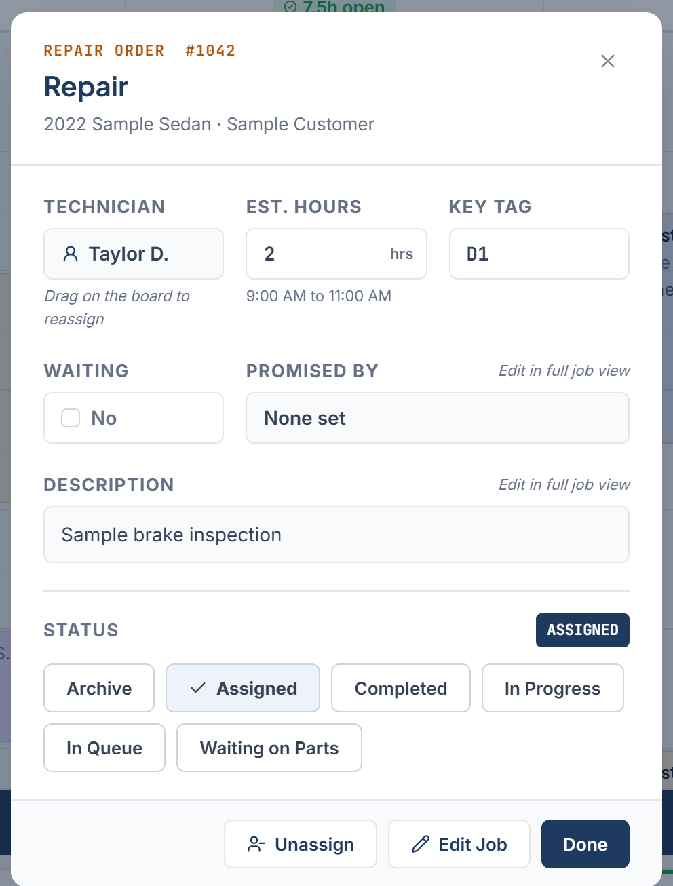
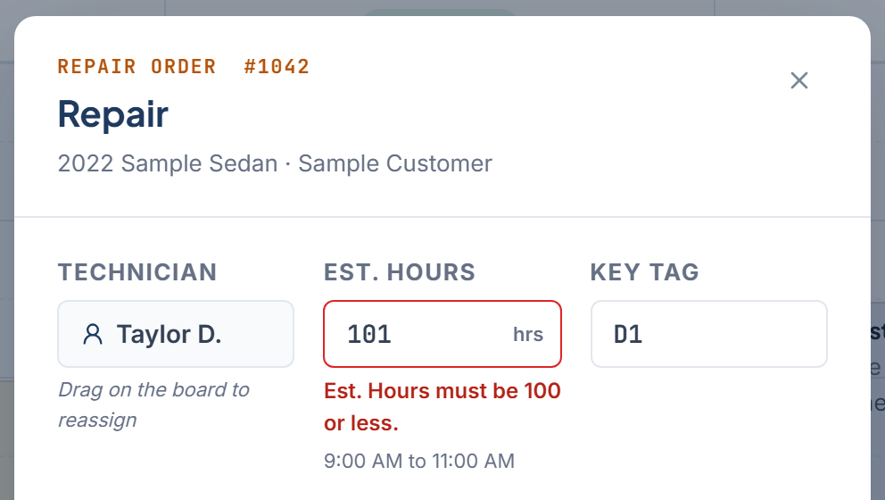

Job Details is the window that opens when you click a job card, or press Enter or Space with a card focused. Every role can open it. Only Owner / Admin, General Manager, Service Advisor, and Foreman can change anything.

<Frame>
  
</Frame>

## What it shows

The header shows the repair order number with the job type, the vehicle, and the customer. Below it:

- **Technician** No. The hint reads "Drag on the board to reassign".
- **Est. Hours** Yes. Commits when you click away. When you change the estimate, enter more than 0 and no more than 100 hours, with up to two decimal places. A value outside those limits shows a message under the field and is not saved. The scheduled span shows under it, such as "9:00 AM to 11:00 AM", or else "Not scheduled" under that same field.
- **Key Tag** Yes.
- **Waiting** Yes. Toggle **Yes** or **No**.
- **Promised By** No. Shows the promise or "None set".
- **Description** No.
- **Status** Yes. Six buttons, one per status.

<Frame>
  
</Frame>

Valid edits commit right away. There is no save button in this window.

## Change the rest with Edit Job

Promised time, description, technician, start time, and RO # are edited in the full drawer. Click **Edit Job** to open it. Change the fields and click **Save Changes**. The drawer uses the same fields as [Add a job](/schedule-board/add-a-job).

RO # stays editable unless the job is Completed. Phone stays locked on edit.

## Footer buttons

- **Unassign** takes the job off the board and back to the Unassigned panel. It appears only for a job scheduled on the day you are viewing that is not Completed.
- **Edit Job** opens the full drawer. It is hidden for archived jobs and for jobs on a day other than the one you are viewing.
- **Done** closes the window.

There is no delete. Archive is the only way to remove a job, and it is reversible. See [Job statuses](/schedule-board/job-statuses).

## When inline editing is unavailable

Est. Hours, Key Tag, and Waiting become read-only when any of these apply:

- Your role is Technician.
- The job is Completed or Archived.
- The job is scheduled on a different day than the one on screen.

Unassigned jobs can be edited inline by an editing role. An editing role can change status on Completed, Archived, and other-day jobs to revert a completion or restore an archived job. To archive a job scheduled for another day, first open that day on the board. Billing and connection restrictions still apply to all changes.

## Related

- [Job statuses](/schedule-board/job-statuses)
- [Promised time](/schedule-board/promised-time)
- [Move or resize a job](/schedule-board/move-or-resize-a-job)
